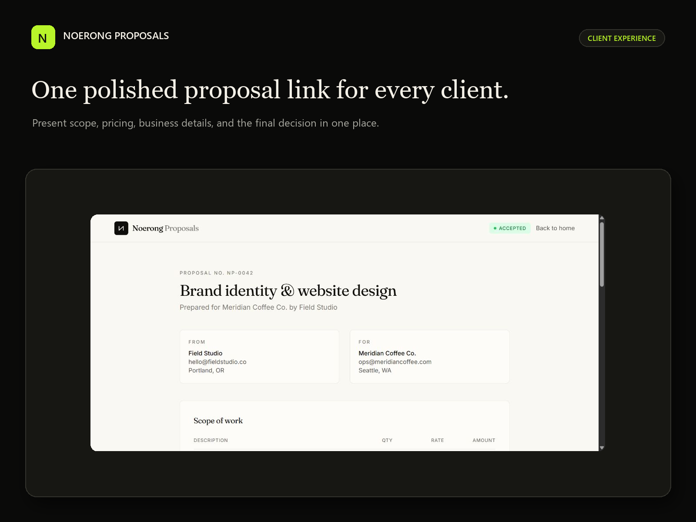

# Noerong Proposals

[](https://github.com/rongali-commits/noerong-proposals/actions/workflows/ci.yml)

**Scope, pricing and the client decision in one clear place.**

[Live product](https://noerong-proposals-sa-ta7h.bolt.host) · [Public sample](https://noerong-proposals-sa-ta7h.bolt.host/sample-proposal) · [Case study](https://noerong.com/projects/noerong-proposals)



A React and TypeScript proposal workspace for independent teams. Organize clients, price a scope, share a client link, and keep comments and decisions attached to the proposal. Sample records demonstrate the workflow, not customer results.

## Included

- Client records, business defaults and proposal management.
- Line quantities, rates and percentage discounts; a capped proposal-level amount discount; tax and rounded totals.
- Authenticated workspace access with Supabase ownership policies.
- Token-based client review, comments and recorded acceptance or rejection.
- Dashboard, sample proposal, signup confirmation and password-reset screens.

Proposal acceptance is a recorded product decision. This repository does not supply payment processing or a legal e-signature service.

## Local setup

Use Node.js 24.

```bash
npm ci
cp .env.example .env.local
npm run dev
```

Replace the two example values with the URL and publishable/anon key of a **new buyer-owned Supabase project**. Apply every SQL migration in `supabase/migrations` in filename order. Configure the authentication site URL and `/reset-password` redirect for your frontend origin.

Deploy `supabase/functions/public-proposal` using `supabase/config.toml`. It accepts public review requests and validates the proposal token server-side, so gateway JWT verification is intentionally off for this function. Set its `ALLOWED_ORIGIN` to the exact production frontend origin. Function server credentials remain in the backend environment and must never be exposed through a `VITE_` value.

The sample page is `/sample-proposal`; the authenticated dashboard is `/dashboard`; client review links use `/p/:token`. Treat active review links as access credentials.

## Checks

```bash
npm run typecheck
npm run lint
npm test
npm run build
```

Pricing tests cover line discounts, decimal rounding, proposal discounts, tax, empty proposals and currency formatting. They run without database access. Database policies, shared-link access and decision transitions must also be verified on a separate test installation before launch.

## Structure

```text
src/lib/calculations.ts             pricing model
src/lib/public-proposal.ts          client-review API adapter
src/pages/                         editor, dashboard, auth and client views
supabase/functions/public-proposal/ token-based client-review endpoint
supabase/migrations/                schema, policies and database functions
tests/                             pricing regressions
```

## Deploy and operate

Build `dist` and host with an SPA fallback. Use buyer-owned frontend/backend accounts, confirmed email delivery, exact auth redirects and the configured function origin. Test user isolation, sharing, expired/invalid links, comments and decisions with synthetic accounts. Define backups, retention, monitoring and support before storing real client information.

## Source and commercial use

An independent Noerong product. Commercial source rights are supplied separately by the studio; public visibility does not grant redistribution rights. [Discuss implementation](https://noerong.com/contact). Dependencies retain their licenses.
